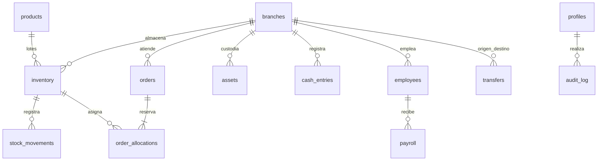

# Arquitectura y alcance

## Capas

El navegador React consume `/api` bajo el mismo origen. Los componentes no acceden a PostgreSQL. Routes define el contrato HTTP; Controllers traduce solicitudes/respuestas; Services concentra autorización y reglas transaccionales; Models contiene esquemas Zod, acceso SQL parametrizado y repositorio de demostración. La interfaz separa Pages, Views, Components, Services y Utils.

Supabase proporciona PostgreSQL y Auth. La autenticación real valida el token con `auth.getUser()`; el rol y la sucursal se consultan en `pharmacy.profiles` en cada petición. El token vive en una cookie HttpOnly, SameSite=Strict, Secure en producción. No se confía en roles enviados por el navegador. La sesión actual requiere volver a entrar al vencer el token (por defecto una hora); no se implementa renovación silenciosa.

Los datos operativos están en un esquema SQL separado llamado `pharmacy`, con RLS habilitada y sin acceso directo para `anon` ni `authenticated`. Las operaciones pasan por el backend, que establece los permisos por rol y sucursal. Una conexión SQL privilegiada puede superar RLS: mantener sus credenciales exclusivamente en el servidor. Un administrador de la base puede modificar la infraestructura, por lo que los triggers de auditoría no son un sistema externo de custodia legal.

## Entidades y relaciones

## Consistencia operativa

- **Inventario:** cada sucursal/producto/lote es único. La reserva no disminuye la cantidad física hasta la entrega. `0 <= reservado <= existencia`. Los lotes vencidos no están disponibles.
- **Pedidos:** se reserva por FEFO (primero en vencer, primero en salir). Se bloquea la combinación sucursal/producto en PostgreSQL dentro de la transacción. Crear el pedido y sus reservas ocurre junto con la auditoría. Cancelar libera reservas. Entregar reduce reservas/existencia y registra un ingreso; la transición de estado evita una segunda entrega.
- **Traslados:** el envío descuenta el origen; la cantidad queda en tránsito hasta que el destino confirma recepción. El estado, la existencia y el movimiento se actualizan dentro de una transacción. Un lote que vence durante el tránsito se recibe para conservar la trazabilidad, pero queda no disponible para venta.
- **Nómina:** empleado y período son únicos. El importe neto se calcula en centavos. El registro de pago bloquea la nómina e inserta el egreso una sola vez. El comprobante corresponde a un pago efectuado fuera del sistema.
- **Caja:** ingresos y egresos no se editan ni borran. Una corrección se hace mediante un movimiento compensatorio con referencia al original. El sistema distingue efectivo, tarjeta y transferencia. No constituye contabilidad de partida doble ni conciliación bancaria.
- **Auditoría:** la escritura de negocio y su entrada de auditoría se confirman juntas. Los cambios de catálogos incluyen valores anteriores y posteriores. PostgreSQL rechaza UPDATE y DELETE sobre los libros de caja, stock y auditoría.
- **Demo:** utiliza una cola de transacciones, copia aislada del estado y reemplazo atómico del archivo. Solo admite un proceso. No debe publicarse ni usarse como almacenamiento empresarial.

## Matriz de acceso

| Rol | Alcance y permisos |
|---|---|
| Administrador | Todos los módulos; catálogos y asignación de roles |
| Auditor | Lectura y exportación; sin cambios operativos |
| Gerente | Inventario, traslados, caja, pedidos y activos de su sucursal |
| Cajero | Inventario de lectura, caja y pedidos de su sucursal |
| Logística | Inventario de lectura, traslados y pedidos; alcance empresarial o sucursal asignada |
| RR. HH. | Empleados y nómina; alcance empresarial o sucursal asignada |

## Integración futura con portal y call center

La API ya separa cotización/reserva/despacho/entrega. El call center puede consultar `/orders/quote` y crear pedidos con `/orders`. El frontend actual exige un usuario autenticado con rol autorizado; **no hay un endpoint anónimo para clientes**. Un portal futuro necesita su propia identidad de cliente y endpoints limitados a sus pedidos. No entregar un token administrador al portal.

Antes de habilitar integraciones: versionar API (`/api/v1`), contratos OpenAPI, claves de idempotencia por solicitud, pedidos con múltiples líneas, reserva con vencimiento automático, webhooks con firma/reintentos y cola de eventos. El pedido actual admite una presentación de medicamento. El ETA es orientativo, sin geocodificación ni tráfico; la cobertura se calcula con radio de 30 km. Se requiere un proveedor de rutas, direcciones verificadas y seguimiento de repartidores para compromisos reales de entrega.

## Trabajo necesario antes de una operación nacional

Esta entrega permite validar flujos y estructura, pero la inversión y expansión descritas requieren fases adicionales:

1. **Requisitos locales y farmacéuticos:** definir recetas, medicamentos controlados, cadena de frío, devoluciones, retiros de lotes, autorizaciones, proveedores y compras con responsables farmacéuticos. No se incluyeron reglas legales inventadas.
2. **Finanzas y nómina:** validar cálculo de deducciones, prestaciones y obligaciones con contabilidad/RR. HH.; integrar facturación fiscal, cierre/arqueo de caja, pasarelas y banco. La depreciación es estimada y configurable por activo, no una declaración fiscal.
3. **Escala:** sustituir el bootstrap de conjuntos completos por consultas paginadas y agregaciones SQL; filtrar en SQL según rol y sucursal; índices ajustados al tráfico; pruebas de carga con metas medibles y presupuesto de conexiones.
4. **Disponibilidad:** varios procesos de API detrás de balanceador, rate limiting compartido, colas, métricas, alertas y recuperación. Compose actual es de un solo servidor; no proporciona alta disponibilidad por sí mismo.
5. **Seguridad:** rol SQL de aplicación con mínimo privilegio, MFA para roles sensibles, recuperación de cuenta, renovación de sesiones, revisión independiente, pruebas de autorización y protección de datos personales.
6. **Auditoría empresarial:** asientos contables, aprobaciones dobles de pagos/ajustes, cierres de períodos, conciliación, bitácora externa y políticas de retención. La trazabilidad técnica incluida no equivale a una auditoría bursátil certificada.
7. **Experiencia operativa:** lector de código de barras, ventas de mostrador con múltiples artículos, impresión fiscal, catálogo editable completo, fotos/documentos de activos y comprobantes, exportaciones por rango de fecha y alertas automáticas.

## Dependencias de referencia

- Supabase Auth y validación de usuario: https://supabase.com/docs/reference/javascript/auth-getuser
- Seguridad y RLS: https://supabase.com/docs/guides/database/secure-data
- PostgreSQL con TLS: https://supabase.com/docs/guides/database/connecting-to-postgres
- Vite/React: https://vite.dev/guide/

No se utiliza Sites porque el entregable solicitado requiere código local React/Node, conexión PostgreSQL y despliegue Docker propios.
